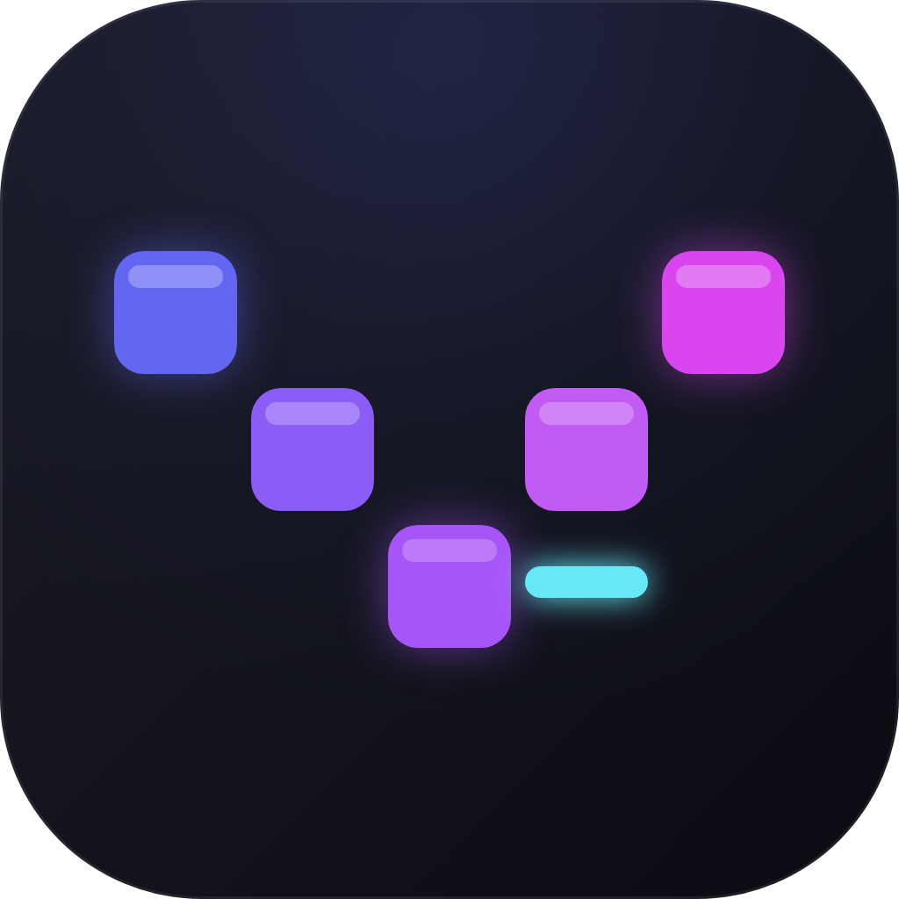

<div align="center">



# VibeKit

**本地离线 · 插件化效率工具箱**

一键呼出的搜索栏 + 沙箱插件 + 零网络依赖，你的桌面效率发射台

[](https://github.com/SuinaCc/vibekit/releases)
[](https://github.com/SuinaCc/vibekit/releases)
[](LICENSE)
[](https://www.electronjs.org/)

</div>

---

## ✨ 特性

- 🔍 **全局搜索栏** — 快捷键一键呼出悬浮搜索框，模糊匹配插件与内置工具，回车即启动，失焦自动隐藏
- 🧩 **插件化架构** — 插件 = 一个 `plugin.json` + 一个 `view.html`，在 iframe 沙箱中运行，与宿主仅通过 Bridge API 通信
- 🔐 **权限模型** — 插件按需声明 `clipboard` / `file-read` / `file-write` 等权限，Bridge 逐调用校验，越权即拦截
- 🎨 **主题系统** — 深色/浅色双模式，支持自定义强调色/表面色/玻璃透明度，插件自动跟随主题
- 🕸 **零网络依赖** — 默认不发任何网络请求，数据全部落在本地 `~/.vibekit/`（SQLite 存储）
- 📱 **手机遥控** — 扫码连接，手机当远程键盘：语音输入（IME）、常用按键、自定义宏，毫秒级注入延迟
- 🖥 **AI 网页快开** — 独立持久会话窗口快开 AI 网站，登录态跨重启保留，与主应用完全隔离

## 🧰 内置插件（13 个）

| 插件 | 说明 |
|---|---|
| 自动化助手 | 命令面板：IP/ping/DNS/HTTP 检查/文本变换/UUID/SHA-256，支持自定义 CMD/PowerShell 脚本 |
| everyCompare | 内容对比工作台：文本（VSCode 级 diff）、图片（滑块/像素 diff/闪烁）、文件、文件夹递归对比 |
| 发票处理 | 本地解析 PDF 发票/行程单，自动配对编号，一键生成报销 Excel，跨文件夹查重 |
| 局域网传文件 | UDP 发现 + TCP 流式传输，SHA-256 校验，可信任设备免确认 |
| 手机遥控 | 手机语音输入 + 按键/宏遥控电脑 + 剪贴板同步，无需 API Key |
| AI 网页快开 | 管理常用 AI 站点列表，F4 呼出持久会话窗口 |
| 剪贴历史 | 本地剪贴板历史记录 |
| 搜索大师 | Everything 全盘文件秒搜 |
| C盘清理 | 磁盘空间分析与大文件清理 |
| 网络工具箱 | 日常网络诊断工具集合 |
| 番茄钟 | 番茄工作法计时 + 喝水/起身提醒 |
| 文件夹收藏 | 常用文件夹快速访问 |
| 白板/黑板 | 手写涂鸦板，投屏讲解利器 |

内置工具：**录屏**、**设置**（不走沙箱，由核心直接提供）。

## 📦 安装

前往 [Releases](https://github.com/SuinaCc/vibekit/releases) 下载最新的 `vibekit-x.x.x-win-x64.exe`，双击安装即可。

> 当前支持 Windows x64（NSIS 安装包）。数据目录：`~/.vibekit/`

## 🚀 开发

```bash
# 安装依赖
npm install

# 开发模式（热更新）
npm run dev

# 类型检查 + 构建
npm run typecheck
npm run build

# 打包 Windows 安装包
npm run package:win
```

**技术栈**：Electron 32 · electron-vite 2 · Vite 5 · TypeScript 5 · SolidJS · TailwindCSS · SQLite

## 🧩 插件开发

一个插件就是一个文件夹，放进 `~/.vibekit/plugins/` 重启即加载：

```
my-plugin/
├── plugin.json   # 清单：id、名称、权限、窗口尺寸
└── view.html     # 全部 UI 和逻辑（单文件）
```

`plugin.json` 示例：

```json
{
  "id": "local.my-plugin",
  "name": "我的插件",
  "permissions": ["clipboard", "file-read"]
}
```

`view.html` 里通过注入的 `window.vibekit` Bridge API 与宿主通信：

```js
const text = await window.vibekit.clipboard.read();
await window.vibekit.storage.set('key', { hello: 'world' });
```

权限逐调用校验：没声明的权限调了直接被拒。开发模板见 [plugins/_template/](plugins/_template/)。

## 🔒 隐私

- 默认**零网络请求、零登录、零遥测**，局域网传输 / AI 网页快开 / 搜索大师需显式开启
- 所有数据（配置、插件数据库）存于本地 `~/.vibekit/`，卸载即删

## 📄 License

[MIT](LICENSE) © SuinaCc
